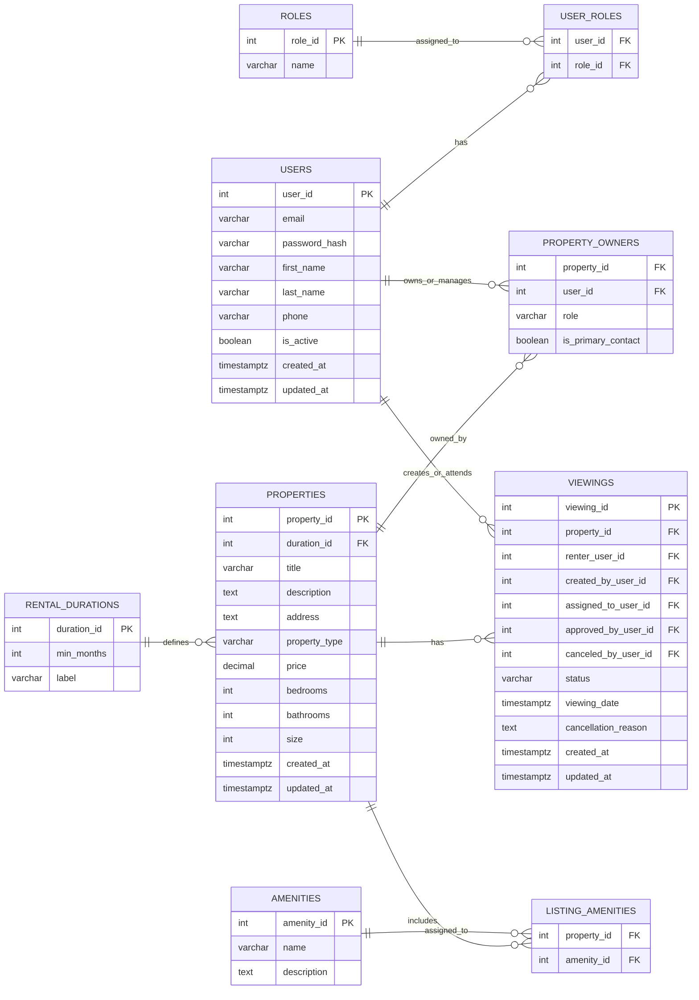

# Rental Marketplace Database

Name: Akram Helil

Purpose: A normalized relational schema to support property listings, amenities, minimum rental durations, and a robust
viewing workflow with explicit user/role-based authorization.

## Overview

- Central identity model (users) represents renters, owners, agents, and admins.
- Properties reference rental_durations for minimum rental rules.
- Amenities are modeled with a many‑to‑many junction (listing_amenities) to properties.
- Viewings capture scheduled visits and include provenance fields (created_by, assigned_to, approved_by, canceled_by) so
  the system can enforce who may post, approve, or manage viewings.
- Authorization is enforced by roles, user_roles, and property_owners (mapping users to properties with a management
  role).

---

## Models, attributes, and constraints

Represents individuals who use the marketplace to browse properties and schedule viewings.

### users

Central identity record for every person or account that interacts with the marketplace (renters, owners, agents,
admins).

#### Responsibility

- Store renter profile information.
- Schedule and manage property viewings.
- Browse properties and amenities.

#### Attributes

| Attribute     | Type         | Notes                                    |
|---------------|--------------|------------------------------------------|
| user_id       | SERIAL PK    | Surrogate primary key                    |
| email         | VARCHAR(255) | NOT NULL UNIQUE Login identifier         |
| password_hash | TEXT         | Nullable for OAuth accounts              |
| first_name    | VARCHAR(100) |
| last_name     | VARCHAR(100) |
| phone         | VARCHAR(30)  | Normalized format recommended            |
| is_active     | BOOLEAN      | NOT NULL DEFAULT TRUE Soft-blocking flag |
| created_at    | TIMESTAMPTZ  | NOT NULL DEFAULT now()                   |
| updated_at    | TIMESTAMPTZ  |

#### Relationships

- 1 → M user_roles (user_id → user_roles.user_id).
- 1 → M property_owners (user_id → property_owners.user_id).
- 1 → M viewings as renter and as provenance actor (renter_user_id, created_by_user_id, assigned_to_user_id,
  approved_by_user_id, canceled_by_user_id).

#### Business Rules

- Email must be unique and not null.
- is_active = false should prevent login and most write actions.
- password_hash may be null only if external auth provider exists; store provider metadata elsewhere.
- Role checks (via user_roles) determine permitted actions; enforce in application layer.

### 2. roles

RCatalog of named roles that define coarse-grained capabilities (e.g., renter, owner, agent, admin).

#### Responsibilities

- Provide a stable set of role names to assign to users.
- Drive authorization decisions in application logic.

#### Attributes

| Attribute | Type        | Note                                              |
|-----------|-------------|---------------------------------------------------|
| role_id   | SERIAL PK   |                                                   |
| name      | VARCHAR(50) | NOT NULL UNIQUE e.g., renter, owner, agent, admin |

#### Relationships

- 1 → M user_roles (role_id → user_roles.role_id).

#### Business Rules

- Role names must be unique.
- Roles are seeded at system initialization.
- Role semantics enforced in application code (DB triggers optional for critical invariants).

## 3. user_roles

Junction table assigning one or more roles to a user.

#### Responsibilities

- Map users to roles.
- Prevent duplicate role assignments.

#### Attributes

| Attribute | Type                    | Note     |
|-----------|-------------------------|----------|
| user_id   | INT FK → users(user_id) | NOT NULL |
| role_id   | INT FK → roles(role_id) | NOT NULL |

#### Relationships

- M → 1 users (user_id).
- M → 1 roles (role_id).

### Business Rules

- Composite primary key (user_id, role_id) prevents duplicates.
- Deleting a user or role cascades to remove assignments.

## 4. rental_durations

Canonical table of minimum rental duration rules (e.g., 1 month, 6 months, 12 months).

#### Attributes

| Attribute   | Type         | Notes                          |
|-------------|--------------|--------------------------------|
| duration_id | SERIAL PK    |                                |
| min_months  | INT          | NOT NULL CHECK min_months >= 0 |
| label       | VARCHAR(100) | Human-friendly label           |
| created_at  | TIMESTAMPTZ  | NOT NULL DEFAULT now()         |

#### Responsibilities

- Define reusable duration rules referenced by properties.
- Centralize duration semantics for validation and UI labels.

#### Relationships

- 1 → M properties (duration_id → properties.duration_id).

#### Business Rules

- min_months must be non-negative.
- ON DELETE RESTRICT on properties referencing durations to avoid orphaned properties.
- Use this table to drive eligibility checks (e.g., tenant minimum stay).

## 5. properties

Listings for rental units available in the marketplace.

#### Responsibilities

- Store listing metadata, pricing, and physical attributes.
- Reference minimum rental duration and link to owners/managers.
- Serve as the parent for viewings and listing amenities

#### Attributes

| Attribute     | Type                                   | Notes                        |
|---------------|----------------------------------------|------------------------------|
| property_id   | SERIAL PK                              |                              |
| duration_id   | INT FK → rental_durations(duration_id) | NOT NULL Minimum rental rule |
| title         | VARCHAR(255)                           |                              |
| description   | TEXT                                   |                              |
| address       | TEXT                                   |
| property_type | VARCHAR(50)                            | e.g., Apartment, House       |
| price         | DECIMAL(12,2)                          | Numeric for sorting/calcs    |
| bedrooms      | INT                                    | CHECK >= 0                   |
| bathrooms     | INT                                    | CHECK >= 0                   |
| size          | INT                                    | CHECK > 0 (sqft or sqm)      |
| created_at    | TIMESTAMPTZ                            | NOT NULL DEFAULT now()       |
| updated_at    | TIMESTAMPTZ                            |                              |

#### Relationships

- M → 1 rental_durations (duration_id).
- 1 → M property_owners (property_id).
- 1 → M listing_amenities (property_id).
- 1 → M viewings (property_id).

#### Business Rules

- duration_id required if every property must have a minimum rental rule.
- price must be non-negative (enforce via CHECK if desired).
- Deleting a property cascades to property_owners, listing_amenities, and viewings (or use soft-delete instead).
- Consider unique business key if integrating external listing IDs.

## 6. property_owners

Mapping of users to properties with a role that indicates ownership or management responsibilities.

#### Responsibilities

- Represent ownership and management relationships (owner, manager, agent).
- Drive authorization for property-level actions (approve/assign viewings).

#### Attributes

| Attribute          | Type        | Notes                                         |
|--------------------|-------------|-----------------------------------------------|
| property_id        | INT         | FK → properties(property_id) NOT NULL         
| user_id            | INT         | FK → users(user_id) NOT NULL                  |
| role               | VARCHAR(20) | NOT NULL CHECK IN ('owner','manager','agent') |
| is_primary_contact | BOOLEAN     | NOT NULL DEFAULT FALSE                        |
| created_at         | TIMESTAMPTZ | NOT NULL DEFAULT now()                        |

#### Relationships

- M → 1 properties (property_id).
- M → 1 users (user_id).

#### Business Rules

- Composite PK (property_id, user_id) prevents duplicate mappings.
- Only users present in this table with appropriate role may be assigned or approve viewings for the property (enforce
  in app logic or triggers).
- Deleting a property or user cascades to remove mappings.

## 7. amenities

Mapping of users to properties with a role that indicates ownership or management responsibilities.

#### Responsibilities

- Provide canonical amenity names and descriptions.
- Avoid duplication of amenity definitions.

#### Attributes

| Attribute   | Type         | Notes                          |
|-------------|--------------|--------------------------------|
| amenity_id  | SERIAL PK    |                                |
| name        | VARCHAR(100) | NOT NULL Consider UNIQUE(name) |
| description | TEXT         |                                |

#### Relationships

- 1 → M listing_amenities (amenity_id).

#### Business Rules

- Amenity names should be normalized (consider UNIQUE (name)).
- Deleting an amenity cascades to listing_amenities to remove associations.

## 8. listing_amenities

Junction table linking properties to amenities (many‑to‑many).

#### Responsibilities

- Record which amenities are offered by each property.
- Prevent duplicate assignments.

#### Attributes

| Attribute   | Type | Notes                                 |
|-------------|------|---------------------------------------|
| property_id | INT  | FK → properties(property_id) NOT NULL |
| amenity_id  | INT  | FK → amenities(amenity_id) NOT NULL   |

#### Relationships

- M → 1 properties (property_id).
- M → 1 amenities (amenity_id).

#### Business Rules

- Composite PK (property_id, amenity_id) prevents duplicates.
- ON DELETE CASCADE recommended on both FKs to clean up associations when a property or amenity is removed.

## 9. viewings

Scheduled appointments for renters to visit properties; includes provenance and workflow state.

#### Responsibilities

- Capture viewing requests, scheduling, approvals, assignments, cancellations, and completion status.
- Provide an auditable record of who performed workflow actions.

#### Attributes

| Attribute           | Type        | Notes                                                                                |
|---------------------|-------------|--------------------------------------------------------------------------------------|
| viewing_id          | SERIAL PK   |                                                                                      |
| property_id         | INT         | FK → properties(property_id) NOT NULL                                                |
| renter_user_id      | INT         | FK → users(user_id) NOT NULL The attendee/requester                                  |
| created_by_user_id  | INT         | FK → users(user_id) NOT NULL Who created the record                                  |
| assigned_to_user_id | INT         | FK → users(user_id) NULL Agent/manager assigned                                      |
| approved_by_user_id | INT         | FK → users(user_id) NULL Approver (owner/agent)                                      |
| canceled_by_user_id | INT         | FK → users(user_id) NULL Who canceled                                                |
| status              | ENUM        | (requested,scheduled,approved,completed,canceled,no_show) NOT NULL DEFAULT requested |
| viewing_date        | TIMESTAMPTZ | NOT NULL                                                                             |
| cancellation_reason | TEXT        |                                                                                      |
| created_at          | TIMESTAMPTZ | NOT NULL DEFAULT now()                                                               |
| updated_at          | TIMESTAMPTZ |                                                                                      |

#### Relationships

- M → 1 properties (property_id).
- M → 1 users (user_id).

#### Business Rules

- Status constraints: restrict values to the defined ENUM or CHECK.
- Provenance enforcement: approved_by_user_id must reference a user present in property_owners for that property with
  role owner|manager|agent (enforce in application layer or via DB trigger).
- Creation rules:
    - Renters create requested viewings (created_by_user_id = renter_user_id).
    - Agents/owners may create scheduled viewings directly for properties they manage.
- Assignment rules: only users in property_owners for the property may be assigned.
    - Cancellation: record canceled_by_user_id and cancellation_reason.
    - Date rules: viewing_date should be in the future at creation (enforce in app or via CHECK/trigger).
- Indexing: index (property_id, viewing_date) and renter_user_id for efficient queries.

---

### Schema

This section describes the database schema, what each table is for, and the design decisions a reader should notice when
using or extending the schema.
Tables and purpose

#### users

- Purpose: Central identity record for every person or account (renters, owners, agents, admins).
- Key columns: user_id PK, email UNIQUE, password_hash, first_name, last_name, phone, is_active, created_at, updated_at.
- Notes: email is the canonical login identifier; password_hash may be NULL for OAuth-only accounts. Use is_active to
  soft-block accounts.

### roles

- Purpose: Canonical list of role names used for coarse authorization (renter, owner, agent, admin).
- Key columns: role_id PK, name UNIQUE.
- Notes: Seeded at system initialization; application logic interprets role semantics.

### user_roles

- Purpose: Junction table mapping users to roles.
- Key columns: user_id FK → users, role_id FK → roles.
- Constraints: Composite primary key (user_id, role_id) prevents duplicate assignments. ON DELETE CASCADE on both FKs to
  automatically clean up assignments when a user or role is removed.

### rental_durations

- Purpose: Canonical minimum rental durations (business reference data).
- Key columns: duration_id PK, min_months CHECK >= 0, label, created_at.
- Notes: Reference data for properties; properties.duration_id uses ON DELETE RESTRICT to prevent removing a duration
  that is in use.

### properties

- Purpose: Listing metadata and pricing for rental units.
- Key columns: property_id PK, duration_id FK → rental_durations, title, description, address, property_type, price
  DECIMAL (12,2), bedrooms CHECK >= 0, bathrooms CHECK >= 0, size CHECK > 0, created_at, updated_at.
- Notes: duration_id enforces minimum-rental rules; add indexes on search columns (price, bedrooms, bathrooms) for
  performance.

### property_owners

- Purpose: Maps users to properties with a management role (owner, manager, agent) and drives property-level
  authorization.
- Key columns: property_id FK → properties, user_id FK → users, role CHECK IN ('owner','manager','agent'),
  is_primary_contact, created_at.
- Constraints: Composite primary key (property_id, user_id) prevents duplicate mappings. ON DELETE CASCADE on parent
  removals.

### amenities

- Purpose: Catalog of amenity types (WiFi, Parking, Pool, etc.).
- Key columns: amenity_id PK, name, description.
- Notes: Consider UNIQUE (name) to avoid duplicates and normalization issues.

### listing_amenities

- Purpose: Junction table linking properties to amenities (many-to-many).
- Key columns: property_id FK → properties, amenity_id FK → amenities.
- Constraints: Composite primary key (property_id, amenity_id) prevents duplicate assignments. ON DELETE CASCADE on both
  FKs to clean up associations.

### viewings

- Purpose: Scheduled visits with provenance and workflow state.
- Key columns: viewing_id PK, property_id FK → properties, renter_user_id FK → users, created_by_user_id FK → users,
  assigned_to_user_id FK → users, - approved_by_user_id FK → users, canceled_by_user_id FK → users, status ENUM,
  viewing_date, cancellation_reason, created_at, updated_at.
- Notes: status is an ENUM (requested, scheduled, approved, completed, canceled, no_show). Provenance fields record who
  performed actions; authorization rules determine who may set them.

---

## ER Diagram



---

---

## Query Catalogue: Units 3 and 4

These queries use the EX 603 rental reference dataset, where `renters` are the actors, `properties` are the producers,
and `viewings` are the events. The main performance metric is `duration_min`, and a viewing with
`viewing_status = 'disputed'` is treated as a failure.

### Unit 3: SQL behavior and data-quality checks

#### 3.1.1 Plain-language property categories

**Business question:** How can property rent and viewing measurements be translated into categories that a nontechnical
reader can understand?

```sql
SELECT v.viewing_id,
       r.renter_name,
       p.property_id,
       p.property_label,
       p.monthly_rent,
       v.travel_km,
       v.interest_score,
       CASE
           WHEN v.travel_km < 10 THEN 'Nearby'
           WHEN v.travel_km < 20 THEN 'Moderate Distance'
           ELSE 'Long Distance'
           END AS travel_category,
       CASE
           WHEN v.interest_score >= 2.0 THEN 'Highly Interested'
           WHEN v.interest_score >= 1.5 THEN 'Interested'
           ELSE 'Low Interest'
           END AS interest_level,
       CASE
           WHEN p.monthly_rent < 1000 THEN 'Budget'
           WHEN p.monthly_rent < 2500 THEN 'Mid-Range'
           ELSE 'Premium'
           END AS rent_category
FROM viewings v
         JOIN renters r ON r.renter_id = v.renter_id
         JOIN properties p ON p.property_id = v.property_id
ORDER BY v.viewing_id;
```

#### 3.1.2 NULL comparison that silently omits rows

**Business question:** How many viewings have a recorded reason other than `Renter no show`, and how many rows are
silently excluded because no reason was recorded?

```sql
SELECT (SELECT COUNT(*)
        FROM viewings
        WHERE no_show_reason != 'Renter no show') AS first_count,
       (SELECT COUNT(*)
        FROM viewings
        WHERE no_show_reason IS NULL)             AS omitted_count,
       (SELECT COUNT(*)
        FROM viewings)                            AS table_total;
```

#### 3.1.3 Corrected NULL-aware filter

**Business question:** How many viewings were not marked as renter no-shows, including viewings with no cancellation
reason?

```sql
SELECT COUNT(*) AS corrected_count
FROM viewings
WHERE no_show_reason != 'Renter no show'
   OR no_show_reason IS NULL;
```

#### 3.1.4 SELECT alias used too early

**Business question:** Which properties are in the Premium rent category?

The following query intentionally demonstrates the alias error because `WHERE` is evaluated before the `SELECT` alias is
created.

```sql
SELECT property_id,
       property_label,
       monthly_rent,
       CASE
           WHEN monthly_rent < 1000 THEN 'Budget'
           WHEN monthly_rent < 2500 THEN 'Mid-Range'
           ELSE 'Premium'
           END AS rent_category
FROM properties
WHERE rent_category = 'Premium';
```

#### 3.1.5 Correct alias rewrite by repeating the expression

**Business question:** Which properties are in the Premium rent category?

```sql
SELECT property_id,
       property_label,
       monthly_rent,
       CASE
           WHEN monthly_rent < 1000 THEN 'Budget'
           WHEN monthly_rent < 2500 THEN 'Mid-Range'
           ELSE 'Premium'
           END AS rent_category
FROM properties
WHERE CASE
          WHEN monthly_rent < 1000 THEN 'Budget'
          WHEN monthly_rent < 2500 THEN 'Mid-Range'
          ELSE 'Premium'
          END = 'Premium';
```

#### 3.1.6 Correct alias rewrite with a CTE

**Business question:** Which properties are in the Premium rent category, using a reusable calculated column?

```sql
WITH property_rent_categories AS (SELECT property_id,
                                         property_label,
                                         monthly_rent,
                                         CASE
                                             WHEN monthly_rent < 1000 THEN 'Budget'
                                             WHEN monthly_rent < 2500 THEN 'Mid-Range'
                                             ELSE 'Premium'
                                             END AS rent_category
                                  FROM properties)
SELECT *
FROM property_rent_categories
WHERE rent_category = 'Premium';
```

#### 3.1.7 Two-step question using IN

**Business question:** Which renters were involved in at least one disputed viewing?

```sql
SELECT renter_id, renter_name
FROM renters
WHERE renter_id IN (SELECT renter_id
                    FROM viewings
                    WHERE viewing_status = 'disputed');
```

#### 3.1.8 Two-step question using a CTE and JOIN

**Business question:** Which distinct renters were involved in disputed viewings?

```sql
WITH disputed_renters AS (SELECT DISTINCT r.renter_id,
                                          r.renter_name
                          FROM renters r
                                   JOIN viewings v ON v.renter_id = r.renter_id
                          WHERE v.viewing_status = 'disputed')
SELECT *
FROM disputed_renters;
```

#### 3.1.9 Two-step question using EXISTS

**Business question:** Which renters have at least one disputed viewing?

```sql
SELECT r.renter_id,
       r.renter_name
FROM renters r
WHERE EXISTS (SELECT 1
              FROM viewings v
              WHERE v.renter_id = r.renter_id
                AND v.viewing_status = 'disputed');
```

#### 3.1.10 CASE-based disputed-renter classification

**Business question:** Which renters can be classified as having a disputed viewing?

```sql
SELECT renter_id, renter_name
FROM (SELECT r.renter_id,
             r.renter_name,
             CASE
                 WHEN EXISTS (SELECT 1
                              FROM viewings v
                              WHERE v.renter_id = r.renter_id
                                AND v.viewing_status = 'disputed') THEN 'Has Disputed Viewing'
                 ELSE 'No Disputed Viewing'
                 END AS dispute_status
      FROM renters r) AS classified_renters
WHERE dispute_status = 'Has Disputed Viewing';
```

### Unit 4: Platform measurement and leadership breakdowns

#### 4.1.1 Overall platform statistics

**Business question:** Across the entire platform, how many viewings occurred, how much viewing time was recorded, what
was the average and range, and how many distinct renters participated?

```sql
SELECT COUNT(*)                    AS total_events,
       ROUND(SUM(duration_min), 2) AS total_viewing_minutes,
       ROUND(AVG(duration_min), 2) AS average_viewing_minutes,
       MIN(duration_min)           AS shortest_viewing_minutes,
       MAX(duration_min)           AS longest_viewing_minutes,
       COUNT(DISTINCT renter_id)   AS distinct_renters
FROM viewings;
```

#### 4.1.2 Activity and average duration by property

**Business question:** Which properties received the most viewing activity, and what was the average viewing duration
for each property?

```sql
SELECT p.property_id,
       p.property_label,
       p.city,
       COUNT(v.viewing_id)           AS event_count,
       ROUND(AVG(v.duration_min), 2) AS average_duration_min
FROM properties p
         LEFT JOIN viewings v ON v.property_id = p.property_id
GROUP BY p.property_id, p.property_label, p.city
ORDER BY event_count DESC, p.property_id;
```

#### 4.1.3 Properties with enough volume for comparison

**Business question:** Which properties have at least 10 viewing events, making their average duration more meaningful?

```sql
SELECT p.property_id,
       p.property_label,
       p.city,
       COUNT(v.viewing_id)           AS event_count,
       ROUND(AVG(v.duration_min), 2) AS average_duration_min
FROM properties p
         JOIN viewings v ON v.property_id = p.property_id
GROUP BY p.property_id, p.property_label, p.city
HAVING COUNT(v.viewing_id) >= 10
ORDER BY event_count DESC, p.property_id;
```

#### 4.1.4 Property performance by booking region

**Business question:** How do viewing activity and duration vary for each property across booking regions?

```sql
SELECT p.property_id,
       p.property_label,
       v.booking_city                AS region,
       COUNT(*)                      AS event_count,
       ROUND(SUM(v.duration_min), 2) AS total_duration_min,
       ROUND(AVG(v.duration_min), 2) AS average_duration_min,
       MIN(v.duration_min)           AS minimum_duration_min,
       MAX(v.duration_min)           AS maximum_duration_min,
       COUNT(DISTINCT v.renter_id)   AS distinct_renters
FROM viewings v
         JOIN properties p ON p.property_id = v.property_id
GROUP BY p.property_id, p.property_label, v.booking_city
ORDER BY p.property_label, event_count DESC, v.booking_city;
```

#### 4.2 Part A: Total events and failures in one pass

**Business question:** For each property, how many total viewings occurred, how many were disputed, and what percentage
of its viewings were disputed?

```sql
SELECT p.property_id,
       p.property_label,
       p.city              AS property_city,
       COUNT(v.viewing_id) AS total_events,
       SUM(
               CASE
                   WHEN v.viewing_status = 'disputed' THEN 1
                   ELSE 0
                   END
       )                   AS disputed_events,
       ROUND(
               100.0 * SUM(
                       CASE
                           WHEN v.viewing_status = 'disputed' THEN 1
                           ELSE 0
                           END
                       ) / NULLIF(COUNT(v.viewing_id), 0),
               2
       )                   AS disputed_rate_percent
FROM properties p
         LEFT JOIN viewings v ON v.property_id = p.property_id
GROUP BY p.property_id, p.property_label, p.city
ORDER BY disputed_events DESC, total_events DESC, p.property_id;
```

#### 4.2 Part B: Regional subtotals and platform grand total

**Business question:** How many total and disputed viewing events occurred in each booking region, and what are the
platform-wide totals?

```sql
SELECT CASE
           WHEN GROUPING(booking_city) = 1 THEN 'All Regions'
           ELSE booking_city
           END  AS region,
       COUNT(*) AS total_viewing_events,
       SUM(
               CASE
                   WHEN viewing_status = 'disputed' THEN 1
                   ELSE 0
                   END
       )        AS disputed_viewing_events,
       CASE
           WHEN GROUPING(booking_city) = 1 THEN 'Platform Grand Total'
           ELSE 'Regional Subtotal'
           END  AS row_type
FROM viewings
GROUP BY GROUPING SETS ( (booking_city),
    ()
    )
ORDER BY GROUPING(booking_city), region;
```

#### 4.2 Part C: High-volume property baseline

**Business question:** Among properties with at least 10 viewing events, what is the normal baseline for viewing volume
and disputed-event performance?

```sql
WITH producer_performance AS (SELECT p.property_id,
                                     p.property_label,
                                     COUNT(v.viewing_id)           AS total_events,
                                     SUM(
                                             CASE
                                                 WHEN v.viewing_status = 'disputed' THEN 1
                                                 ELSE 0
                                                 END
                                     )                             AS disputed_events,
                                     ROUND(AVG(v.duration_min), 2) AS average_duration_min
                              FROM properties p
                                       JOIN viewings v ON v.property_id = p.property_id
                              GROUP BY p.property_id, p.property_label)
SELECT COUNT(*)                            AS high_volume_property_count,
       ROUND(AVG(total_events), 2)         AS average_events_per_property,
       ROUND(AVG(disputed_events), 2)      AS average_disputes_per_property,
       SUM(total_events)                   AS combined_events,
       SUM(disputed_events)                AS combined_disputed_events,
       ROUND(
               100.0 * SUM(disputed_events)
                   / NULLIF(SUM(total_events), 0),
               2
       )                                   AS high_volume_disputed_rate_percent,
       ROUND(AVG(average_duration_min), 2) AS average_property_duration_min
FROM producer_performance
WHERE total_events >= 10;
```

#### 4.3 Leadership failure-rate check

**Business question:** What is the platform's true disputed-viewing rate, and which properties should leadership
investigate first?

```sql
SELECT COUNT(*) AS total_viewings,
       SUM(
               CASE
                   WHEN viewing_status = 'disputed' THEN 1
                   ELSE 0
                   END
       )        AS disputed_viewings,
       ROUND(
               100.0 * SUM(
                       CASE
                           WHEN viewing_status = 'disputed' THEN 1
                           ELSE 0
                           END
                       ) / COUNT(*),
               2
       )        AS platform_failure_rate_percent
FROM viewings;
```

#### Unit 5: Joins, missing records, and execution plans

Unit 5 extends the Unit 4 analysis by connecting viewing events to renters, properties, and amenities. It also
identifies properties that disappear from inner-join reports and examines how PostgreSQL executes a three-table join.

##### 5.1.1 Three-table viewing activity report

**Business question:** Which renter performed each viewing, which property was involved, and when was the event
scheduled?

```sql
SELECT v.viewing_id,
       r.renter_id,
       r.renter_name    AS actor_name,
       p.property_id,
       p.property_label AS producer_name,
       v.scheduled_at   AS event_date_time,
       v.viewing_status
FROM viewings AS v
         INNER JOIN renters AS r
                    ON v.renter_id = r.renter_id
         INNER JOIN properties AS p
                    ON v.property_id = p.property_id
ORDER BY v.scheduled_at,
         v.viewing_id;
```

This query supports a Viewing Activity Report for the Property Operations Manager. It replaces standalone identifiers
with renter names, property labels, event dates, and viewing outcomes.

##### 5.1.2 Catalog tags through the junction table

**Business question:** Which amenities are associated with the high-failure properties identified in Unit 4?

```sql
SELECT p.property_id,
       p.property_label,
       p.city,
       a.amenity_id,
       a.amenity_name,
       la.verified_on
FROM properties AS p
         INNER JOIN listing_amenities AS la
                    ON p.property_id = la.property_id
         INNER JOIN amenities AS a
                    ON la.amenity_id = a.amenity_id
WHERE p.property_id IN (1, 3, 5)
ORDER BY p.property_id,
         a.amenity_name;
```

The junction table is necessary because a property can have several amenities and the same amenity can belong to several
properties. Property IDs 1 and 5 share Pool, while Property IDs 3 and 5 share Gym. These are patterns to investigate,
not evidence that an amenity caused a dispute.

##### 5.1.3 Self-join property comparison

**Business question:** How do the high-failure properties compare with other properties in the same city by rent,
availability, and viewing activity?

```sql
WITH property_activity AS (SELECT p.property_id,
                                  p.property_label,
                                  p.city,
                                  p.monthly_rent,
                                  p.is_available,
                                  COUNT(v.viewing_id) AS viewing_count
                           FROM properties AS p
                                    LEFT JOIN viewings AS v
                                              ON p.property_id = v.property_id
                           GROUP BY p.property_id,
                                    p.property_label,
                                    p.city,
                                    p.monthly_rent,
                                    p.is_available)
SELECT p1.property_id                                   AS investigated_property_id,
       p1.property_label                                AS investigated_property,
       p2.property_id                                   AS comparison_property_id,
       p2.property_label                                AS comparison_property,
       p1.city,
       p1.monthly_rent                                  AS investigated_rent,
       p2.monthly_rent                                  AS comparison_rent,
       ROUND(ABS(p1.monthly_rent - p2.monthly_rent), 2) AS rent_difference,
       p1.viewing_count                                 AS investigated_viewings,
       p2.viewing_count                                 AS comparison_viewings,
       p1.is_available                                  AS investigated_available,
       p2.is_available                                  AS comparison_available
FROM property_activity AS p1
         INNER JOIN property_activity AS p2
                    ON p1.city = p2.city
                        AND p1.property_id <> p2.property_id
WHERE p1.property_id IN (1, 3, 5)
ORDER BY p1.property_id,
         p2.property_id;
```

Properties 1, 3, and 5 all have monthly rents near $3,200, but their viewing volumes differ. The comparison highlights
useful differences without claiming that rent, availability, or activity caused the disputes.

##### 5.2.A.1 LEFT JOIN including properties with no events

**Business question:** How many viewing events does every property have, including properties that have never had an
event?

```sql
SELECT p.property_id,
       p.property_label,
       COUNT(v.viewing_id) AS total_viewings
FROM properties AS p
         LEFT JOIN viewings AS v
                   ON p.property_id = v.property_id
GROUP BY p.property_id,
         p.property_label
ORDER BY p.property_id;
```

The `LEFT JOIN` retains all 15 properties. Property IDs 14 and 15 appear with zero viewings.

##### 5.2.A.2 INNER JOIN excluding properties with no events

**Business question:** How many viewing events does each property have when the report includes only properties with
matching events?

```sql
SELECT p.property_id,
       p.property_label,
       COUNT(v.viewing_id) AS total_viewings
FROM properties AS p
         INNER JOIN viewings AS v
                    ON p.property_id = v.property_id
GROUP BY p.property_id,
         p.property_label
ORDER BY p.property_id;
```

The `INNER JOIN` returns 13 properties and excludes Property IDs 14 and 15 because they have no matching viewing
records.

##### 5.2.A.3 Count and identify properties excluded by the INNER JOIN

**Business question:** How many properties disappear from the inner-join report, and which properties are they?

```sql
SELECT COUNT(DISTINCT p.property_id) AS excluded_property_count
FROM properties AS p
         LEFT JOIN viewings AS v
                   ON p.property_id = v.property_id
WHERE v.viewing_id IS NULL;
```

```sql
SELECT p.property_id,
       p.property_label,
       'No recorded viewing events' AS exclusion_reason
FROM properties AS p
         LEFT JOIN viewings AS v
                   ON p.property_id = v.property_id
WHERE v.viewing_id IS NULL
ORDER BY p.property_id;
```

The excluded-property count is 2. The missing producers are Property IDs 14 and 15.

##### 5.2.B.1 RIGHT JOIN equivalent to the LEFT JOIN

**Business question:** Can a RIGHT JOIN return the same all-property summary as the LEFT JOIN?

```sql
SELECT p.property_id,
       p.property_label,
       COUNT(v.viewing_id) AS total_viewings
FROM viewings AS v
         RIGHT JOIN properties AS p
                    ON v.property_id = p.property_id
GROUP BY p.property_id,
         p.property_label
ORDER BY p.property_id;
```

The `RIGHT JOIN` preserves the `properties` table because it appears on the right. It returns the same 15 property
summaries as the earlier `LEFT JOIN`.

##### 5.2.B.2 Verify LEFT JOIN and RIGHT JOIN equivalence

**Business question:** Do the LEFT JOIN and RIGHT JOIN return exactly the same property summaries?

```sql
WITH left_join_results AS (SELECT p.property_id,
                                  p.property_label,
                                  COUNT(v.viewing_id) AS total_viewings
                           FROM properties AS p
                                    LEFT JOIN viewings AS v
                                              ON p.property_id = v.property_id
                           GROUP BY p.property_id, p.property_label),
     right_join_results AS (SELECT p.property_id,
                                   p.property_label,
                                   COUNT(v.viewing_id) AS total_viewings
                            FROM viewings AS v
                                     RIGHT JOIN properties AS p
                                                ON v.property_id = p.property_id
                            GROUP BY p.property_id, p.property_label)
SELECT (SELECT COUNT(*)
        FROM (SELECT *
              FROM left_join_results
              EXCEPT
              SELECT *
              FROM right_join_results) AS left_only) AS rows_only_in_left_join,
       (SELECT COUNT(*)
        FROM (SELECT *
              FROM right_join_results
              EXCEPT
              SELECT *
              FROM left_join_results) AS right_only) AS rows_only_in_right_join;
```

Both difference counts should be zero.

##### 5.2.B.3 FULL OUTER JOIN validation

**Business question:** Which property-viewing records match, and are there unmatched records on either side?

```sql
SELECT p.property_id,
       p.property_label,
       v.viewing_id,
       v.viewing_status,
       CASE
           WHEN p.property_id IS NULL
               THEN 'Viewing without a matching property'
           WHEN v.viewing_id IS NULL
               THEN 'Property without a viewing'
           ELSE 'Matched property and viewing'
           END AS match_status
FROM properties AS p
         FULL OUTER JOIN viewings AS v
                         ON p.property_id = v.property_id
ORDER BY p.property_id NULLS LAST,
         v.viewing_id NULLS LAST;
```

The full outer join reveals unmatched records from both sides. In this dataset, it finds Properties 14 and 15 without
viewings. The foreign-key constraint prevents valid viewing rows from referencing missing properties.

##### 5.2.C.1 Properties with no events using NOT EXISTS

**Business question:** Which properties have never had a recorded viewing event?

```sql
SELECT p.property_id,
       p.property_label
FROM properties AS p
WHERE NOT EXISTS (SELECT 1
                  FROM viewings AS v
                  WHERE v.property_id = p.property_id)
ORDER BY p.property_id;
```

##### 5.2.C.2 Properties with no events using EXCEPT

**Business question:** Which property identifiers exist in the producer table but never appear in the event table?

```sql
SELECT p.property_id,
       p.property_label
FROM properties AS p
WHERE p.property_id IN (SELECT property_id
                        FROM properties
                        EXCEPT
                        SELECT property_id
                        FROM viewings)
ORDER BY p.property_id;
```

Both approaches return Property IDs 14 and 15. `NOT EXISTS` checks each property for a matching viewing, while `EXCEPT`
subtracts the viewed-property identifiers from all property identifiers.

##### 5.3.A.1 CROSS JOIN source counts

**Business question:** How many properties and amenities participate in the Cartesian product?

```sql
SELECT (SELECT COUNT(*) FROM properties) AS property_count,
       (SELECT COUNT(*) FROM amenities)  AS amenity_count;
```

The source tables contain 15 properties and 5 amenities.

##### 5.3.A.2 CROSS JOIN result count

**Business question:** How many possible property-and-amenity combinations are created?

```sql
SELECT COUNT(*) AS cross_join_row_count
FROM properties AS p
         CROSS JOIN amenities AS a;
```

The cross join returns 75 rows because 15 properties multiplied by 5 amenities equals 75 combinations.

##### 5.3.A.3 Verify the Cartesian-product calculation

**Business question:** Does the CROSS JOIN count equal the two source-table counts multiplied together?

```sql
SELECT property_count,
       amenity_count,
       property_count * amenity_count               AS expected_rows,
       actual_rows,
       property_count * amenity_count = actual_rows AS counts_match
FROM (SELECT COUNT(*) AS property_count FROM properties) AS p
         CROSS JOIN
         (SELECT COUNT(*) AS amenity_count FROM amenities) AS a
         CROSS JOIN
     (SELECT COUNT(*) AS actual_rows
      FROM properties
               CROSS JOIN amenities) AS result;
```

A Cartesian product can support a complete property-and-amenity audit grid. It may indicate a query error when it
appears unintentionally because a missing join condition can multiply unrelated rows.

##### 5.3.B.1 EXPLAIN the three-table join

**Business question:** How does PostgreSQL plan to connect renters, viewings, and properties?

```sql
EXPLAIN
SELECT v.viewing_id,
       r.renter_id,
       r.renter_name    AS actor_name,
       p.property_id,
       p.property_label AS producer_name,
       v.scheduled_at   AS event_date_time,
       v.viewing_status
FROM viewings AS v
         INNER JOIN renters AS r
                    ON v.renter_id = r.renter_id
         INNER JOIN properties AS p
                    ON v.property_id = p.property_id
ORDER BY v.scheduled_at,
         v.viewing_id;
```

##### 5.3.B.2 Measured execution plan

**Business question:** What join algorithms and access methods does PostgreSQL actually use for the three-table report?

```sql
EXPLAIN (ANALYZE, BUFFERS)
SELECT v.viewing_id,
       r.renter_id,
       r.renter_name    AS actor_name,
       p.property_id,
       p.property_label AS producer_name,
       v.scheduled_at   AS event_date_time,
       v.viewing_status
FROM viewings AS v
         INNER JOIN renters AS r
                    ON v.renter_id = r.renter_id
         INNER JOIN properties AS p
                    ON v.property_id = p.property_id
ORDER BY v.scheduled_at,
         v.viewing_id;
```

The captured plan used a Hash Join between `viewings` and `renters`, followed by a Nested Loop to connect properties.
PostgreSQL used sequential scans for `viewings` and `renters`, an index scan on `properties_pkey`, Memoize for repeated
property lookups, and a final sort by `scheduled_at` and `viewing_id`.

##### 5.3.B.3 Example indexes for future growth

**Business question:** Which indexes may become useful if the viewing table grows substantially?

```sql
CREATE INDEX idx_viewings_property_id
    ON viewings (property_id);

CREATE INDEX idx_viewings_renter_id
    ON viewings (renter_id);

ANALYZE viewings;
ANALYZE properties;
ANALYZE renters;
```

These indexes may help selective queries that request a small number of properties or renters. Queries that return most
viewing rows may still favor sequential scans and hash joins.

##### 5.4 Leadership recommendations

**Business question:** What different actions should leadership take for high-failure properties and properties with no
activity?

- Property IDs 1, 3, and 5 should receive a quality and dispute review because they have viewing activity and elevated
  dispute rates.
- Property IDs 14 and 15 should receive an activation and listing-visibility review because they have no recorded
  viewing events.
- The first group needs investigation into problems occurring during renter interactions. The second group needs
  confirmation that the listings are visible, available, accurate, and ready to accept viewing requests.
- The data identifies the two groups, but it does not establish the cause of the disputes or inactivity.
