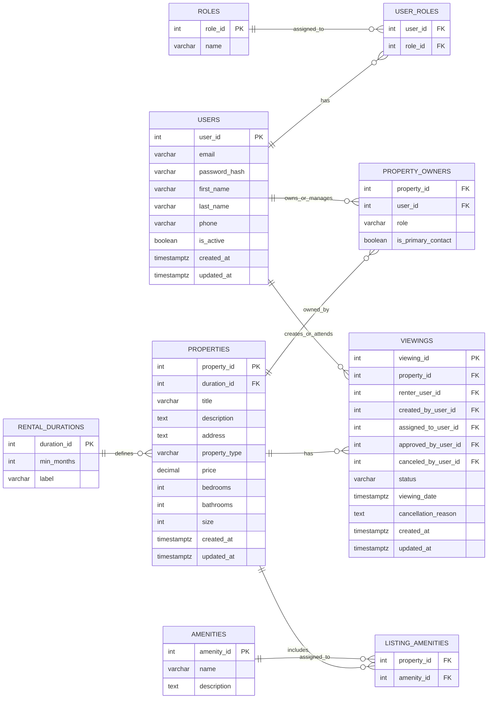

# Rental Marketplace Database

Name: Akram Helil

Purpose: A normalized relational schema to support property listings, amenities, minimum rental durations, and a robust viewing workflow with explicit user/role-based authorization.

## Overview

- Central identity model (users) represents renters, owners, agents, and admins.
- Properties reference rental_durations for minimum rental rules.
- Amenities are modeled with a many‑to‑many junction (listing_amenities) to properties.
- Viewings capture scheduled visits and include provenance fields (created_by, assigned_to, approved_by, canceled_by) so the system can enforce who may post, approve, or manage viewings.
- Authorization is enforced by roles, user_roles, and property_owners (mapping users to properties with a management role).
---
## Models, attributes, and constraints

Represents individuals who use the marketplace to browse properties and schedule viewings.

### users

Central identity record for every person or account that interacts with the marketplace (renters, owners, agents, admins).

#### Responsibility

- Store renter profile information.
- Schedule and manage property viewings.
- Browse properties and amenities.

#### Attributes

| Attribute | Type | Notes |
| ------------ | ------ | ------------- |
|user_id| SERIAL PK| Surrogate primary key|
|email |VARCHAR(255)| NOT NULL UNIQUE Login identifier|
|password_hash| TEXT | Nullable for OAuth accounts|
|first_name| VARCHAR(100) |
|last_name| VARCHAR(100) |
|phone | VARCHAR(30) |Normalized format recommended|
|is_active |BOOLEAN| NOT NULL DEFAULT TRUE Soft-blocking flag|
|created_at | TIMESTAMPTZ |NOT NULL DEFAULT now()|
|updated_at |TIMESTAMPTZ |

#### Relationships

- 1 → M user_roles (user_id → user_roles.user_id).
- 1 → M property_owners (user_id → property_owners.user_id).
- 1 → M viewings as renter and as provenance actor (renter_user_id, created_by_user_id, assigned_to_user_id, approved_by_user_id, canceled_by_user_id).

#### Business Rules

- Email must be unique and not null.
- is_active = false should prevent login and most write actions.
- password_hash may be null only if external auth provider exists; store provider metadata elsewhere.
- Role checks (via user_roles) determine permitted actions; enforce in application layer.

### 2. roles

RCatalog of named roles that define coarse-grained capabilities (e.g., renter, owner, agent, admin).

#### Responsibilities

- Provide a stable set of role names to assign to users.
- Drive authorization decisions in application logic.

#### Attributes

| Attribute | Type | Note |
| ------------ | ------ | ------------- |
| role_id | SERIAL PK | |
| name | VARCHAR(50) | NOT NULL UNIQUE e.g., renter, owner, agent, admin |

#### Relationships

- 1 → M user_roles (role_id → user_roles.role_id).

#### Business Rules

- Role names must be unique.
- Roles are seeded at system initialization.
- Role semantics enforced in application code (DB triggers optional for critical invariants).

## 3. user_roles

Junction table assigning one or more roles to a user.

#### Responsibilities

- Map users to roles.
- Prevent duplicate role assignments.

#### Attributes

| Attribute | Type | Note |
| ------------ | ------ | ------------- |
| user_id | INT FK → users(user_id) | NOT NULL |
| role_id | INT FK → roles(role_id) | NOT NULL |

#### Relationships

- M → 1 users (user_id).
- M → 1 roles (role_id).

### Business Rules

- Composite primary key (user_id, role_id) prevents duplicates.
- Deleting a user or role cascades to remove assignments.

## 4. rental_durations

Canonical table of minimum rental duration rules (e.g., 1 month, 6 months, 12 months).

#### Attributes

|Attribute |Type| Notes|
| ------------ | ------ | ------------- |
| duration_id |SERIAL PK| |
|min_months |INT |NOT NULL CHECK min_months >= 0|
|label| VARCHAR(100)| Human-friendly label|
|created_at| TIMESTAMPTZ| NOT NULL DEFAULT now()|

#### Responsibilities

- Define reusable duration rules referenced by properties.
- Centralize duration semantics for validation and UI labels.

#### Relationships

- 1 → M properties (duration_id → properties.duration_id).

#### Business Rules

- min_months must be non-negative.
- ON DELETE RESTRICT on properties referencing durations to avoid orphaned properties.
- Use this table to drive eligibility checks (e.g., tenant minimum stay).

## 5. properties

Listings for rental units available in the marketplace.

#### Responsibilities

- Store listing metadata, pricing, and physical attributes.
- Reference minimum rental duration and link to owners/managers.
- Serve as the parent for viewings and listing amenities

#### Attributes

| Attribute | Type | Notes |
| ------------ | ------ | ------------- |
|property_id| SERIAL PK| |
|duration_id| INT FK → rental_durations(duration_id)| NOT NULL Minimum rental rule|
|title |VARCHAR(255)| |
|description| TEXT| |
|address |TEXT |
|property_type| VARCHAR(50)| e.g., Apartment, House|
|price| DECIMAL(12,2)| Numeric for sorting/calcs|
|bedrooms| INT |CHECK >= 0|
|bathrooms| INT| CHECK >= 0|
|size |INT| CHECK > 0 (sqft or sqm)|
|created_at| TIMESTAMPTZ| NOT NULL DEFAULT now()|
|updated_at| TIMESTAMPTZ| |

#### Relationships

- M → 1 rental_durations (duration_id).
- 1 → M property_owners (property_id).
- 1 → M listing_amenities (property_id).
- 1 → M viewings (property_id).

#### Business Rules

- duration_id required if every property must have a minimum rental rule.
- price must be non-negative (enforce via CHECK if desired).
- Deleting a property cascades to property_owners, listing_amenities, and viewings (or use soft-delete instead).
- Consider unique business key if integrating external listing IDs.

## 6. property_owners

Mapping of users to properties with a role that indicates ownership or management responsibilities.

#### Responsibilities

- Represent ownership and management relationships (owner, manager, agent).
- Drive authorization for property-level actions (approve/assign viewings).

#### Attributes

| Attribute | Type | Notes |
| ------------ | ------ | ------------- |
|property_id| INT | FK → properties(property_id) NOT NULL
|user_id |INT |FK → users(user_id) NOT NULL|
|role| VARCHAR(20)| NOT NULL CHECK IN ('owner','manager','agent')|
|is_primary_contact| BOOLEAN| NOT NULL DEFAULT FALSE |
|created_at |TIMESTAMPTZ |NOT NULL DEFAULT now() |

#### Relationships

- M → 1 properties (property_id).
- M → 1 users (user_id).

#### Business Rules

- Composite PK (property_id, user_id) prevents duplicate mappings.
- Only users present in this table with appropriate role may be assigned or approve viewings for the property (enforce in app logic or triggers).
- Deleting a property or user cascades to remove mappings.

## 7. amenities

Mapping of users to properties with a role that indicates ownership or management responsibilities.

#### Responsibilities

- Provide canonical amenity names and descriptions.
- Avoid duplication of amenity definitions.

#### Attributes

| Attribute | Type | Notes |
| ------------ | ------ | ------------- |
|amenity_id| SERIAL PK||
|name| VARCHAR(100)| NOT NULL Consider UNIQUE(name)|
| description |TEXT ||

#### Relationships

- 1 → M listing_amenities (amenity_id).

#### Business Rules

- Amenity names should be normalized (consider UNIQUE(name)).
- Deleting an amenity cascades to listing_amenities to remove associations.

## 8. listing_amenities

Junction table linking properties to amenities (many‑to‑many).

#### Responsibilities

- Record which amenities are offered by each property.
- Prevent duplicate assignments.

#### Attributes

| Attribute | Type | Notes |
| ------------ | ------ | ------------- |
| property_id | INT | FK → properties(property_id) NOT NULL |
| amenity_id | INT | FK → amenities(amenity_id) NOT NULL |

#### Relationships

- M → 1 properties (property_id).
- M → 1 amenities (amenity_id).

#### Business Rules

- Composite PK (property_id, amenity_id) prevents duplicates.
- ON DELETE CASCADE recommended on both FKs to clean up associations when a property or amenity is removed.

## 9. viewings

Scheduled appointments for renters to visit properties; includes provenance and workflow state.

#### Responsibilities

- Capture viewing requests, scheduling, approvals, assignments, cancellations, and completion status.
- Provide an auditable record of who performed workflow actions.

#### Attributes

| Attribute | Type | Notes |
| ------------ | ------ | ------------- |
|viewing_id| SERIAL PK| |
|property_id| INT| FK → properties(property_id) NOT NULL|
|renter_user_id |INT |FK → users(user_id) NOT NULL The attendee/requester|
|created_by_user_id| INT| FK → users(user_id) NOT NULL Who created the record|
|assigned_to_user_id |INT |FK → users(user_id) NULL Agent/manager assigned|
|approved_by_user_id |INT| FK → users(user_id) NULL Approver (owner/agent)|
|canceled_by_user_id|INT| FK → users(user_id) NULL Who canceled|
|status |ENUM| (requested,scheduled,approved,completed,canceled,no_show) NOT NULL DEFAULT requested|
|viewing_date | TIMESTAMPTZ| NOT NULL|
|cancellation_reason |TEXT | |
|created_at |TIMESTAMPTZ |NOT NULL DEFAULT now()|
|updated_at |TIMESTAMPTZ| |

#### Relationships

- M → 1 properties (property_id).
- M → 1 users (user_id).

#### Business Rules

- Status constraints: restrict values to the defined ENUM or CHECK.
- Provenance enforcement: approved_by_user_id must reference a user present in property_owners for that property with role owner|manager|agent (enforce in application layer or via DB trigger).
- Creation rules:
  - Renters create requested viewings (created_by_user_id = renter_user_id).
  - Agents/owners may create scheduled viewings directly for properties they manage.
- Assignment rules: only users in property_owners for the property may be assigned.
  - Cancellation: record canceled_by_user_id and cancellation_reason.
  - Date rules: viewing_date should be in the future at creation (enforce in app or via CHECK/trigger).
- Indexing: index (property_id, viewing_date) and renter_user_id for efficient queries.

---
### Schema

This section describes the database schema, what each table is for, and the design decisions a reader should notice when using or extending the schema.
Tables and purpose

#### users
- Purpose: Central identity record for every person or account (renters, owners, agents, admins).
- Key columns: user_id PK, email UNIQUE, password_hash, first_name, last_name, phone, is_active, created_at, updated_at.
- Notes: email is the canonical login identifier; password_hash may be NULL for OAuth-only accounts. Use is_active to soft-block accounts.

### roles

- Purpose: Canonical list of role names used for coarse authorization (renter, owner, agent, admin).
- Key columns: role_id PK, name UNIQUE.
- Notes: Seeded at system initialization; application logic interprets role semantics.

### user_roles

- Purpose: Junction table mapping users to roles.
- Key columns: user_id FK → users, role_id FK → roles.
- Constraints: Composite primary key (user_id, role_id) prevents duplicate assignments. ON DELETE CASCADE on both FKs to automatically clean up assignments when a user or role is removed.

### rental_durations
- Purpose: Canonical minimum rental durations (business reference data).
- Key columns: duration_id PK, min_months CHECK >= 0, label, created_at.
- Notes: Reference data for properties; properties.duration_id uses ON DELETE RESTRICT to prevent removing a duration that is in use.

### properties

- Purpose: Listing metadata and pricing for rental units.
- Key columns: property_id PK, duration_id FK → rental_durations, title, description, address, property_type, price DECIMAL(12,2), bedrooms CHECK >= 0, bathrooms CHECK >= 0, size CHECK > 0, created_at, updated_at.
- Notes: duration_id enforces minimum-rental rules; add indexes on search columns (price, bedrooms, bathrooms) for performance.

### property_owners
- Purpose: Maps users to properties with a management role (owner, manager, agent) and drives property-level authorization.
- Key columns: property_id FK → properties, user_id FK → users, role CHECK IN ('owner','manager','agent'), is_primary_contact, created_at.
- Constraints: Composite primary key (property_id, user_id) prevents duplicate mappings. ON DELETE CASCADE on parent removals.

### amenities
- Purpose: Catalog of amenity types (WiFi, Parking, Pool, etc.).
- Key columns: amenity_id PK, name, description.
- Notes: Consider UNIQUE(name) to avoid duplicates and normalization issues.

### listing_amenities

- Purpose: Junction table linking properties to amenities (many-to-many).
- Key columns: property_id FK → properties, amenity_id FK → amenities.
- Constraints: Composite primary key (property_id, amenity_id) prevents duplicate assignments. ON DELETE CASCADE on both FKs to clean up associations.

### viewings

- Purpose: Scheduled visits with provenance and workflow state.
- Key columns: viewing_id PK, property_id FK → properties, renter_user_id FK → users, created_by_user_id FK → users, assigned_to_user_id FK → users, - approved_by_user_id FK → users, canceled_by_user_id FK → users, status ENUM, viewing_date, cancellation_reason, created_at, updated_at.
- Notes: status is an ENUM (requested, scheduled, approved, completed, canceled, no_show). Provenance fields record who performed actions; authorization rules determine who may set them.

---
## ER Diagram

---
